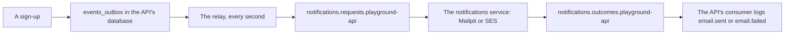

# playground

The test product of the zigordev platform: an API with its own PostgreSQL and a web app, deployed to <https://playground.zigordev.com> by every green merge to `main`. People sign up, sign in and keep their notes there, in English or Spanish, and the emails of sign-in go out through the notifications service. It was made on 2026-11-24 from the product template of [toolkit](https://github.com/zigordev/toolkit) at version 1.19.0, took a fresh copy of it at version 1.46.0 on 2026-11-26, and keeps the template's shape on purpose.

## What it is

A product on the platform is an API and a web app that is one of its clients. The playground is the smallest product of that shape, wired with the shared packages that toolkit publishes on npm as `@zigordev/*`.

| Path                                   | What it holds                                                                                                                                                                                                                                                               |
| -------------------------------------- | --------------------------------------------------------------------------------------------------------------------------------------------------------------------------------------------------------------------------------------------------------------------------- |
| `apps/playground-api`                  | The API: a Fastify service on `@zigordev/api` with a greeting behind a feature flag, the notes and sign-in, whose emails it sends to the notifications service over Kafka. Its flags in `flags.json`, its migrations in `drizzle/`, its `openapi.json` and its `Dockerfile` |
| `apps/playground-web`                  | The web app: a Next.js app that shows what the API says and holds the sign-in pages, its texts in `messages/en.json` and `messages/es.json`, its inlang project in `project.inlang/`, and the `Dockerfile` of it                                                            |
| `packages/playground-api-client`       | The API's typed client: the types written from `openapi.json`, and `createPlaygroundApiClient()` on openapi-fetch                                                                                                                                                           |
| `packages/playground-client-generator` | The one package that writes those types, with openapi-typescript on its own TypeScript 5.9.3                                                                                                                                                                                |
| `compose.yaml`                         | The whole product as it runs everywhere: both apps, the API's migrate job and the product's PostgreSQL, each with its limits and health check                                                                                                                               |
| `compose.local.yaml`                   | What differs on the laptop: the images are built here, and the address is `playground.localhost`                                                                                                                                                                            |
| `compose.production.yaml`              | What differs in production: the address, and that the deploy runs the migrate job itself                                                                                                                                                                                    |
| `compose.test.ts`                      | The test that holds the three compose files and the two Dockerfiles to the container rules                                                                                                                                                                                  |
| `package.json`                         | The scripts `local:up`, `local:down`, `local:reset` and `check:contract`                                                                                                                                                                                                    |
| `.env.production.example`              | The names of the secrets that production needs. Only the names: the values live in AWS Parameter Store                                                                                                                                                                      |
| `.github/workflows/ci.yml`             | The repo's caller: the pipeline on every pull request, then publish and deploy on every merge to `main`                                                                                                                                                                     |
| `docs/`                                | How to start it on a clean laptop, how it reaches production, what a user can do, and the decisions about this repo                                                                                                                                                         |

Its product name is `playground`, so its apps are `playground-api` and `playground-web`. Every app has one name, in its folder, its package, its compose service, its image and its telemetry.

## Why it exists

It has two jobs.

- **It proves the platform.** It is the product of step 3.9 of the Build plan: a version deployed from a merge with no manual step, a broken version that rolls itself back, and a host destroyed and rebuilt that serves it again within an hour. After that, every new version of toolkit reaches it through Renovate, as it reaches every product.
- **It is the owner's place to try the platform's pieces together**, through pull requests like any other change.

[Record 0001](docs/adr/0001-the-playground-is-the-platforms-public-test-product.md) holds the decision.

## What it is built with

| Tool                             | What it does here                                                                                        |
| -------------------------------- | -------------------------------------------------------------------------------------------------------- |
| Node.js 26                       | Runs both apps. The API's TypeScript files run directly, with no build step                              |
| Fastify 5                        | Serves the API's routes                                                                                  |
| Next.js 16                       | Builds the web app, and renders its page on the server at each request                                   |
| React 19                         | The web app's pages                                                                                      |
| next-intl                        | Picks each request's language, and gives each page its texts in English or Spanish                       |
| `@zigordev/ui`                   | Every button, field, checkbox and message on the pages, from the design system, in light and in dark     |
| React Hook Form                  | Every form, checked by a Zod schema, with each problem shown under its field in the person's language    |
| TanStack Query                   | The notes forms' writes from the browser, through `openapi-react-query` on the typed client              |
| Playwright and axe               | Open every page in Chromium and check it for accessibility and for its content security policy           |
| The inlang CLI                   | Checks the texts inside `pnpm check`, through the `texts` rule of `zigordev check`                       |
| `@zigordev/config`               | Reads each app's settings from the environment once, and stops the app when one is wrong                 |
| `@zigordev/otel`                 | Each app's traces, metrics and log lines, and the answer of its health route                             |
| `@zigordev/api`                  | The API's base: the error format, paging, sign-in checks, the OpenAPI pages, the database and the stop   |
| PostgreSQL 18                    | The product's database, in a container of its own on a network of its own                                |
| Drizzle                          | The API's queries, and with drizzle-kit the SQL of each migration                                        |
| `@zigordev/test`                 | A real PostgreSQL for the API's tests, with one migrated copy per test file, and a real Kafka            |
| `@zigordev/events`               | Saves each email request in the API's own database, sends it on to Kafka, and reads what became of it    |
| `@zigordev/notifications-events` | The request and outcome events of the notifications service, and the names of their topics               |
| Docker Compose                   | Runs the product as one project of two containers, on the network of the shared services                 |
| The Node.js image                | The official image on Alpine Linux, at the same Node.js version as `mise.toml`. Both images are built on |
| Vitest 5                         | Tests the routes and the page, each app once as a real process, and the compose files                    |

## Quick start

There are two ways to run it. The first is the product as it runs in production, in containers. The second is the two apps as plain processes, which needs no Docker.

### In containers, behind the shared services

It needs Docker. The shared services come with it: the ingress, the telemetry agent and Grafana are the package `@zigordev/stack`, which [platform](https://github.com/zigordev/platform) publishes and this folder takes from npm. From this folder:

```bash
pnpm local:up
```

The script has two halves. `zigordev-stack up` starts the shared services and waits until each one is healthy. When they already run, it changes nothing. `docker compose up` then builds both images, starts both containers, and returns when both are healthy. The first build takes a few minutes, most of them downloads.

| Address                                    | Answers                                                                                                                                     |
| ------------------------------------------ | ------------------------------------------------------------------------------------------------------------------------------------------- |
| `http://playground.localhost`              | The page. It reads "Hello from playground-api"                                                                                              |
| `http://playground.localhost/api/v1/hello` | The API, at the same address as the page: `{"message":"Hello from playground-api"}`                                                         |
| `http://playground.localhost/health`       | The web app's health: `ok` while the API is up, and `degraded` while it is down                                                             |
| `http://grafana.localhost`                 | Grafana. The dashboard named App, in the folder zigordev, lists `playground-api` and `playground-web`                                       |
| `http://mail.localhost`                    | Mailpit, with the emails that sign-in sent, once the notifications service runs too, as [the emails](#the-emails-through-notifications) say |

`pnpm local:down` stops and removes the two containers, and leaves the shared services running, because other products use them. `pnpm local:reset` does the same, removes the product's volumes, and starts it again.

[The laptop platform](https://github.com/zigordev/toolkit/blob/main/docs/handbook/the-laptop-platform.md) explains the shared services and what an app does to be served. [Telemetry](https://github.com/zigordev/toolkit/blob/main/docs/handbook/telemetry.md) follows one request of the template, which this product copies, through Grafana, as a trace, a log line and a metric.

### While you edit one app: hot reload

With the product up in containers, run the one app you are editing on this Mac itself. From this folder:

```bash
pnpm dev web
pnpm dev api
```

| Command        | What runs                                                   | Its address             | A saved change                               |
| -------------- | ----------------------------------------------------------- | ----------------------- | -------------------------------------------- |
| `pnpm dev web` | `next dev`, the web app's dev server                        | `http://127.0.0.1:3001` | Shows on the next look at the page, at once  |
| `pnpm dev api` | The API under `node --watch`, which restarts it on a change | `http://127.0.0.1:3000` | The API answers with it about a second later |

No image is built, and the rest of the product keeps running in its containers, behind the shared services. `pnpm dev` alone says how to name the app.

By default the web app's dev server asks the API in its container, through the ingress at `http://playground.localhost`. So `pnpm local:up` has to run first. To see a change of the API on the page, run both: `pnpm dev api` in one terminal, and this in a second:

```bash
API_URL=http://127.0.0.1:3000 pnpm dev web
```

Each app reads its dev settings from its own `.env.development`. The file holds no secret, so it is committed. The app checks those settings with the same schema as in its container, and a variable set in the shell wins over the file. A missing setting stops the app with the same message as in its container. The API's watcher then waits for a change of a file before it tries again.

A dev process differs from its container in a few ways, all on purpose:

| What                | In its container                       | With `pnpm dev`                                                             |
| ------------------- | -------------------------------------- | --------------------------------------------------------------------------- |
| Where it listens    | Port 3000, reached through the ingress | `127.0.0.1` only, so nothing outside this Mac reaches it                    |
| Its version         | `local`                                | `dev`, so Grafana tells the two copies apart                                |
| Its log lines       | Read by the agent, and kept in Grafana | Printed in the terminal, where the agent does not read them                 |
| The API's telemetry | Sent to the agent at `alloy:4318`      | Sent to the agent at `127.0.0.1:4318`, giving up on a send after one second |
| The web's telemetry | Sent to the agent                      | None: `next dev` runs without `@zigordev/otel/register`, see below          |

The web app's dev server also keeps the browser's console out of its own log, with `logging.browserToTerminal: false` in `next.config.ts`. Next.js 16.4.6 writes each browser message into `.next/dev/logs`, and that write made the dev server rebuild and reload the page, which logged again, so every page reloaded forever.

The web app's dev server sends no traces and no metrics. `next dev` compiles a page the first time it is asked for, so its timings say nothing about the app. And the register entry turns every line printed to the console into a JSON line, which would hide the compiler's messages from the person reading the terminal. To see the web app's telemetry, run it in its container.

The API's dev process sends to the agent's port on this Mac, `127.0.0.1:4318`. The shared services publish it from `@zigordev/stack` 1.1.0 on, which this product takes. When the agent cannot be reached there, the dev API writes one error line a minute about it, and carries on. That happens while the shared services are stopped, or when they were last started by a product that holds an older `@zigordev/stack`. The short send timeout keeps a restart at about a second either way.

## The settings

| Variable                                             | Read by          | What it holds                                                                        | When it is not set                              |
| ---------------------------------------------------- | ---------------- | ------------------------------------------------------------------------------------ | ----------------------------------------------- |
| `OTEL_SERVICE_NAME`                                  | Both             | The app's one name                                                                   | The app does not start                          |
| `OTEL_SERVICE_VERSION`                               | Both             | The version that runs, shown in its logs, traces and metrics                         | It is left out                                  |
| `LOG_LEVEL`                                          | Both             | `debug`, `info`, `warn` or `error`                                                   | `info`                                          |
| `PORT`                                               | Both             | The port the app listens on                                                          | 3000                                            |
| `HOST`                                               | The API          | The address it listens on                                                            | `0.0.0.0`, every one                            |
| `DATABASE_URL`                                       | The API, the job | The address of the app's database, as its own role                                   | The app does not start                          |
| `API_KEYS`                                           | The API          | The callers it knows, as JSON: a name, the SHA-256 of the key and the scopes         | Nobody, so every notes request gets 401         |
| `FLAGS_FILE`                                         | The API          | The path of its flags file                                                           | Its own `flags.json`, beside its `package.json` |
| `AUTH_SECRET`, `AUTH_URL`                            | The API          | Sign-in's secret of at least 32 characters, and the origin browsers use              | Sign-in is off: no `/api/auth/*`, only API keys |
| `AUTH_GOOGLE_CLIENT_ID`, `AUTH_GOOGLE_CLIENT_SECRET` | The API          | A Google OAuth client, to offer Google                                               | Sign-in offers email and passkeys only          |
| `KAFKA_BROKERS`, `KAFKA_USERNAME`, `KAFKA_PASSWORD`  | The API          | The broker as `host:port`, and the API's Kafka user and password. All three, or none | Kafka is off, and sign-in cannot be turned on   |
| `DATABASE_ADMIN_URL`                                 | The job          | The superuser's address, to make the app's role and database                         | The job only migrates                           |
| `API_URL`                                            | The web          | Where the web app's server reaches the API                                           | The app does not start                          |
| `OTEL_EXPORTER_OTLP_ENDPOINT`                        | OpenTelemetry    | Where the telemetry goes. The compose file names the agent                           | `http://localhost:4318`                         |
| `OTEL_RESOURCE_ATTRIBUTES`                           | OpenTelemetry    | The environment the app runs in, as `local` or `production`                          | It is left out                                  |

The compose files set every one of them that a container needs. An app reads nothing but environment variables.

## The notes API

Slice 2 gives the API its first real feature: notes, kept in the product's PostgreSQL.

| Method and path                 | Operation    | Scope         | Answers                              |
| ------------------------------- | ------------ | ------------- | ------------------------------------ |
| `GET /api/v1/notes`             | `listNotes`  | `notes:read`  | 200 with a page of notes             |
| `POST /api/v1/notes`            | `createNote` | `notes:write` | 201 with the note and its `Location` |
| `GET /api/v1/notes/{noteId}`    | `getNote`    | `notes:read`  | 200 with the note, or 404            |
| `PATCH /api/v1/notes/{noteId}`  | `updateNote` | `notes:write` | 200 with the changed note, or 404    |
| `DELETE /api/v1/notes/{noteId}` | `deleteNote` | `notes:write` | 204, or 404                          |

A list filters by `status` and by `q`, a text that the title holds in any case, sorts by `createdAt`, `updatedAt` or `title`, newest first unless asked, and pages with `limit` and `cursor`. Every error is a problem in the platform's format, and the docs page at `/api/v1/docs` shows them all.

Who reaches which note, as [record 0054](https://github.com/zigordev/toolkit/blob/main/docs/adr/0054-a-signed-in-person-reaches-only-the-notes-they-wrote.md) says:

| Caller                                  | Reaches                                                                 | Needs                                                 |
| --------------------------------------- | ----------------------------------------------------------------------- | ----------------------------------------------------- |
| A person who is signed in               | The notes they wrote. Any other note answers 404, as a missing one does | Their session, and no scope                           |
| A caller with an API key                | Every note, including the people's. A note it makes belongs to nobody   | The scope of the route: `notes:read` or `notes:write` |
| Nobody, or an API key without the scope | Nothing: 401 without credentials, 403 without the scope                 |                                                       |

Each note keeps its writer in `owner_id`, and a person's notes are deleted with their account.

A caller signs in with an API key in `Authorization: Bearer <key>`. The API keeps only the SHA-256 of each key, in `API_KEYS`, so the key itself is never in a setting the API reads. To try the notes on this Mac, make a key and start the API with it:

```bash
KEY=$(openssl rand -hex 16)
DIGEST=$(printf '%s' "$KEY" | shasum -a 256 | cut -d' ' -f1)
API_KEYS="[{\"name\":\"me\",\"sha256\":\"$DIGEST\",\"scopes\":[\"notes:read\",\"notes:write\"]}]" pnpm dev api
```

Then `curl -H "authorization: Bearer $KEY" http://127.0.0.1:3000/api/v1/notes` lists the notes.

### The database

The product's PostgreSQL runs as `playground-postgres`, on the network `playground`, which only the API and its job join. On the laptop it also answers at `127.0.0.1:5434`, so that `pnpm dev api` reaches it. The API connects as its own role, `playground_api`, to its own database, `playground_api`.

Before the API starts, the one-shot job `playground-api-migrate` runs on the API's own image: it makes the role and the database when they are missing, and applies the migrations in `apps/playground-api/drizzle/`. On the laptop the API waits for it. In production the deploy runs it once, before the new version starts, and stops when it fails. The handbook page [Data](https://github.com/zigordev/toolkit/blob/main/docs/handbook/data.md) explains why.

A change to the tables is a migration, and a change to a route regenerates the OpenAPI file:

```bash
pnpm --dir apps/playground-api run db:generate --name add_notes_pinned
pnpm --dir apps/playground-api run openapi
```

The first writes the SQL of a schema change into `drizzle/`, which is read and committed as it is. The second writes `openapi.json`, and a test fails while the file and the code differ.

### The client

`packages/playground-api-client` is the typed client of the API. Its types are written from `openapi.json`, so a changed endpoint breaks the code that calls it when it compiles, not in production:

```ts
import { createPlaygroundApiClient } from 'playground-api-client';

const api = createPlaygroundApiClient({ baseUrl: 'http://playground-api:3000', key });
const { data, error } = await api.GET('/api/v1/notes', { params: { query: { status: 'open' } } });
```

After a change to `openapi.json`, write the types again with `pnpm --dir packages/playground-api-client run generate`. A test fails while they differ from the file. The generator runs on TypeScript 5.9.3, because openapi-typescript does not run on TypeScript 7. toolkit's [record 0036](https://github.com/zigordev/toolkit/blob/main/docs/adr/0036-the-client-generator-runs-on-its-own-typescript-5.md) says why, and when that ends.

## Sign-in

People sign in through [`@zigordev/auth`](https://github.com/zigordev/toolkit/blob/main/packages/auth/README.md), with email and a password, passkeys, optional two-factor and Google, as [record 0050](https://github.com/zigordev/toolkit/blob/main/docs/adr/0050-sign-in-carries-over-novembers-design.md) says. Better Auth runs in the API, which serves `/api/auth/*`, keeps users and sessions in the API's own database, and answers `GET /api/v1/me` with the person who is signed in. Every other route takes a session or an API key: a person who is signed in reaches the notes they wrote, and an API key needs the notes scopes, as [the notes API](#the-notes-api) says.

- **On this Mac, in containers:** sign-in is on at `http://playground.localhost`, as `compose.local.yaml` sets.
- **With the dev servers:** run `pnpm dev api`, and `API_URL=http://127.0.0.1:3000 pnpm dev web` as [hot reload](#while-you-edit-one-app-hot-reload) shows, then open `http://localhost:3001`. The web app forwards `/api/auth/*` to the API on its own origin, and the API has sign-in on for that origin, from `apps/playground-api/.env.development`. The API also reads an untracked `.env.local` beside it, which is where the Google client's two values go. Git ignores every `.env*.local` file.
- **In production:** sign-in is on at `https://playground.zigordev.com`, as `compose.production.yaml` sets. Its secret is `PLAYGROUND_API_AUTH_SECRET`, which the owner stores in Parameter Store, and its emails reach the notifications service, as [the emails](#the-emails-through-notifications) say. It offers email and passkeys, because Google needs a client for that address first.

Sign-in sends four emails: verify an address, choose a new password, someone tried to sign up with your address, and confirm a deletion. The API builds each with [`@zigordev/email`](https://github.com/zigordev/toolkit/blob/main/packages/email/README.md), in the language the browser asks for, and the notifications service delivers it, as the next section says.

The web app has the pages: `/sign-in` with a password, Google or a passkey, `/sign-up`, `/two-factor` for the authenticator's code or a backup code, and `/account` to add a passkey, turn on two-factor, sign out or delete the account. They use `@zigordev/auth/client` and the design system. `/sign-in` sends a person who is signed in on to `next`, only a path on this site, and `/account` sends a person who is not to `/sign-in` and back.

### Google on this Mac

The owner's client `template on this Mac`, in the Google Cloud project `zigordev`, sends people back to `http://localhost:3001/api/auth/callback/google`, because Google accepts plain http only for `localhost`. The playground's dev servers use that same address, so the client works here too, with the dev servers and not at `playground.localhost`:

1. Put `AUTH_GOOGLE_CLIENT_ID` and `AUTH_GOOGLE_CLIENT_SECRET` in `apps/playground-api/.env.local`.
2. With the product up, run `pnpm dev api`, and `API_URL=http://127.0.0.1:3000 pnpm dev web`.
3. Open `http://localhost:3001/sign-in` and choose "Continue with Google".

## The emails through notifications

The API never sends mail itself. It hands each email to the notifications service as a request event over Kafka, and reads what became of it, as [record 0042](https://github.com/zigordev/toolkit/blob/main/docs/adr/0042-notifications-takes-requests-and-gives-outcomes-over-kafka.md) says. Kafka is reached only through [`@zigordev/events`](https://github.com/zigordev/toolkit/blob/main/packages/events/README.md), and the events themselves come from [`@zigordev/notifications-events`](https://github.com/zigordev/notifications/blob/main/packages/notifications-events/README.md), which the notifications repo publishes.



1. Sign-in calls the API's sender, which saves the email as an `email.requested` event in the table `events_outbox`, in the API's own database. The request holds the address, the subject and both bodies, and the labels `template` and `locale`.
2. The relay of `@zigordev/events` sends the saved events to the topic `notifications.requests.playground-api` within a second. While Kafka is down they wait in the table, and sign-up keeps working.
3. The notifications service delivers the email, from `no-reply@zigordev.com`, the first sender of `playground-api` in its `producers.json`. On this Mac the email lands in Mailpit.
4. The service answers on `notifications.outcomes.playground-api`, and the API's consumer, in the group `playground-api.email-outcomes`, logs the answer.

The request's id comes from the key that sign-in gives each email: it is the SHA-256 of the app's name and the key, written as a UUID of version 8. The notifications service accepts an id once, so a retry never sends twice, and the notice that someone tried to sign up with an address goes out at most once in each ten-minute window, as `@zigordev/auth` promises.

| Log event         | Level | Fields                                        | Written when                                           |
| ----------------- | ----- | --------------------------------------------- | ------------------------------------------------------ |
| `email.requested` | info  | `requestId`, `template`                       | The request is saved in the outbox                     |
| `email.sent`      | info  | `requestId`, `attempts`                       | The notifications service says the mail server took it |
| `email.failed`    | warn  | `requestId`, `attempts`, `reason`, `smtpCode` | The notifications service says it will never send it   |

No line carries an address, a subject or a link. `@zigordev/events` adds the numbers of the outbox, the consumer's lag and the dead letters, and `/health` names two parts. `kafka` turns the answer to `degraded`, not `error`, while Kafka is down. `topics` turns it to `error` while Kafka says that a topic the API reads does not exist, a mistake in the setup that a deploy must not ship.

Kafka is optional. The three `KAFKA_` settings come all together or not at all, and sign-in needs them. Without them the API starts no relay and no consumer.

### What the broker and the service need first

| What                                                                                                                                   | Where                                                                                                                                                                                                                                                                    |
| -------------------------------------------------------------------------------------------------------------------------------------- | ------------------------------------------------------------------------------------------------------------------------------------------------------------------------------------------------------------------------------------------------------------------------ |
| The two topics of `playground-api` with their dead-letter topics, and the rule that lets the notifications service set a request aside | `platform`, in `KAFKA_SETUP`, so on every broker, production's included, since [platform#91](https://github.com/zigordev/platform/pull/91): the service reads the request topic of every app in its `producers.json`, and one missing topic stops it reading any of them |
| The Kafka user `playground-api`, and the rules that let it write its requests and read its outcomes                                    | `platform`, in `KAFKA_SETUP` too, because the playground runs in production. Its password is `local-only-playground-api` on the laptop, and lives once at `/playground/KAFKA_PASSWORD` in production                                                                     |
| The entry of `playground-api` in `apps/notifications-api/producers.json`                                                               | `notifications`, since [notifications#29](https://github.com/zigordev/notifications/pull/29). It comes after the topics, which `platform` makes first                                                                                                                    |

The playground reads that password as `KAFKA_PASSWORD`, a name in its `.env.production.example` without the app's name in front, and the shared services read the same parameter to make its Kafka user, as `platform`'s record 0028 says.

### Try it on this Mac

Start the shared services and the playground, from this folder:

```bash
pnpm local:up
```

The shared services start the notifications service too, from its published image, after Kafka's topics and users are made. Nothing else has to run.

Sign up at `http://playground.localhost/sign-up`, or at `http://localhost:3001/sign-up` with the dev servers of [hot reload](#while-you-edit-one-app-hot-reload). The email arrives in Mailpit at `http://mail.localhost` within a few seconds, from `no-reply@zigordev.com`, and its button confirms the address and signs the person in. The API's `email.requested` and `email.sent`, and the service's `email.accepted` and `email.sent`, carry the same trace.

`pnpm dev api` reaches the broker at `localhost:9094`, the port that the shared services publish for apps outside a container, with the settings in `apps/playground-api/.env.development`.

### How the tests check it

`src/features/account/sign-in.db.test.ts` runs every sign-in path against a real PostgreSQL and a real Kafka, which the API tests' global setup starts. It also checks that a signed-in person reaches only the notes they wrote, and that their notes go with their account. The file makes topics of its own with `createTopics` from `@zigordev/events/testing`, and runs a stand-in for the notifications service on them: it reads each request, keeps it, and answers `email.sent`, or `email.failed` for an address at `refused.example.com`. The tests follow the links in the requests' plain text, and check the logs of both answers, the one notice in ten minutes, and that no log line carries an address or a link.

## The texts in English and Spanish

Every text of the web app exists in English and in Spanish, in `apps/playground-web/messages/en.json` and `messages/es.json`, under the same names. [Web apps](https://github.com/zigordev/toolkit/blob/main/docs/handbook/web-apps.md) explains the whole of it: how a page reads its texts, how a request picks its language, and the check.

- **The language:** the one the person chose with the switch at the top of every page, kept in the cookie `playground.locale`. Without a choice, the browser's `Accept-Language`, and then English. The address stays the same in both languages.
- **The texts in a page:** `getTranslations('signIn')` in a server component, `useTranslations('signIn')` in a component that runs in the browser. The names are typed from `en.json`.
- **The sign-in pages' problems:** the functions in `src/lib/sign-in.ts` answer with a code, such as `wrong-credentials`, and the page puts it into words in the person's language. Better Auth's own messages are in English, so they never reach the page.
- **The check:** `pnpm exec zigordev check texts` runs `inlang check` on `apps/playground-web/project.inlang`, and fails on a text missing or empty in one language, short of a variable, or used by no code.

The emails of sign-in pick their language from the browser's `Accept-Language`, not from the switch: the API, which builds them, does not see the web app's cookie.

## The notes pages

A person who is signed in keeps their notes at `/notes`. Each page sends a person who is not signed in to `/sign-in`, and back afterwards.

| Page              | What it does                                                                                                                                                                                     |
| ----------------- | ------------------------------------------------------------------------------------------------------------------------------------------------------------------------------------------------ |
| `/notes`          | Lists the person's notes, newest first, with a search on the titles, a filter on open or done, and "Show more" for the next page. The address holds all of it, as `?status=done&q=milk&cursor=…` |
| `/notes/new`      | A form for a new note: a title and a text                                                                                                                                                        |
| `/notes/{noteId}` | The note in the same form, with the box "Done", and a delete that asks once more. Another person's note answers 404                                                                              |

The pages follow the web rules. A server component reads the API on the server, through the typed client of `packages/playground-api-client`, with the person's cookie, so the list and the note arrive in the page. A form in the browser writes through TanStack Query and `openapi-react-query`, on the same typed client, then moves on and asks the server for the page again. The API decides whose notes these are, as [the notes API](#the-notes-api) says.

In containers the ingress sends `/api` to the API, so the browser's requests reach it at the page's own address. The dev server and the page check have no ingress, so `src/app/api/v1/[...path]/route.ts` hands those requests on to `API_URL`, as `src/app/api/auth/[...all]/route.ts` does for sign-in.

## The pages and their security

Every page wears the design system, `@zigordev/ui`, and follows the person's light or dark setting. The root layout draws a header, with the product's name and the language switch, and one `<main>`. The forms use React Hook Form with the Zod schemas of `apps/playground-web/src/lib/forms.ts`, so a field that fails says why under it, in the person's language. [Web apps](https://github.com/zigordev/toolkit/blob/main/docs/handbook/web-apps.md) explains each part.

`apps/playground-web/src/proxy.ts` gives every page a content security policy with a fresh nonce: only scripts and styles that carry it run, from the page's own address, and nothing may show the page in a frame. So every page is rendered per request. The app has its own 404 page and error page, in both languages, because those of Next.js set inline styles.

`pnpm test:browser`, from the root, runs the web app's browser tests and then its page check, in Chromium. The browser tests render each form and the account's buttons, click and type as a person would, and cover every module named `*.client.tsx`, which `pnpm check` leaves out of its coverage, against the same floor of 90%. The page check starts the web app from its build with a stand-in for the API, and opens every page: in English and Spanish, in light and in dark. It fails on any finding of axe, on anything the policy blocks and on any error in the browser. The pipeline's Browser job runs both on every pull request. Run `pnpm build` first, and `pnpm exec playwright install chromium` once.

A test of the web app never writes out a text: it reads it from the messages with `textsIn` from `apps/playground-web/test/texts.ts`, so a translator who changes a text in Fink breaks no test.

## The feature flags

The API keeps its flags in `apps/playground-api/flags.json`, and reads them in the app through [`@zigordev/flags`](https://github.com/zigordev/toolkit/blob/main/packages/flags/README.md). Its image carries the file, so a flag changes through a pull request and takes effect with the deploy. No flag server runs.

The playground has one flag, `friendly-greeting`, and it is off. `GET /api/v1/hello` answers `Hello from playground-api` while it is off, and `Hi there, from playground-api` once a pull request sets its `defaultVariant` to `on`. It is the smallest example of a feature that ships switched off.

Every flag carries a removal date in `metadata.removeBy`. The `flags` rule of `zigordev check` fails `pnpm check` on a flag past its date, so `friendly-greeting` has to go, or its date has to move, by 2027-11-30. The playground removes it with its first real flag.

A test sets a flag by pointing `FLAGS_FILE` at a file of its own, as the API's `app.test.ts` does for the friendly greeting.

## How each app starts

Both start the same way: Node.js loads `@zigordev/otel/register` with `--import`, before any code of the app. Telemetry is then in place when the web server is created, so each request gets a span and a duration, in the web app too. The last line of each `Dockerfile` is that same command.

An app that misses a setting stops at once: it writes which settings are wrong to its error output, and ends with code 1 before it takes a request. The API gets this from Node.js, which ends a process on an error that nobody caught. Next.js catches what its start hook throws and carries on, so the web app ends the process itself. Its start hook is `src/instrumentation.ts`, and the part of it that only Node.js can run is `src/lib/start.ts`.

The API's start lives in `src/start.ts` too. `start()` reads the settings, builds the app, listens and writes `service.started`. The server it returns has a `stop()`, which writes `service.stopping`, closes the app, sends the last telemetry and gives the exit code. `stopOnSignals()` calls it on a SIGTERM or a SIGINT. `src/main.ts` is the two lines that join them.

That keeps every line that does something inside the tests' reach. A test that starts `src/main.ts` as a process of its own proves the real start and stop, but coverage cannot see inside that process. This product counts the coverage of its apps and packages, against the same floor of 90% as toolkit.

## How it runs in containers

`compose.yaml` describes each service once, the way it runs everywhere. The other two files hold only what differs.

| What                 | In `compose.yaml`                                                                                                                                    | Why                                                                                                                                                                  |
| -------------------- | ---------------------------------------------------------------------------------------------------------------------------------------------------- | -------------------------------------------------------------------------------------------------------------------------------------------------------------------- |
| The image            | `ghcr.io/zigordev/<app>:${VERSION:-local}`                                                                                                           | One image per app, tagged with the version that runs                                                                                                                 |
| The version          | `VERSION` also becomes `OTEL_SERVICE_VERSION`                                                                                                        | The telemetry names the same version as the image. A laptop build is `local`                                                                                         |
| The user             | `user: "1000:1000"`, the user `node` of the image                                                                                                    | Nothing runs as root                                                                                                                                                 |
| The file system      | `read_only: true`. Each app gets `/tmp` in memory, of 1 MiB, for the drain below, and the web app one more folder of 64 MiB for the cache of Next.js | A process that is broken into can change no file                                                                                                                     |
| The privileges       | `cap_drop: [ALL]` and `no-new-privileges`                                                                                                            | The process holds no special right and can gain none                                                                                                                 |
| The first process    | `init: true`                                                                                                                                         | Signals reach the app, and no dead child process stays behind                                                                                                        |
| The stop             | `stop_grace_period: 30s`                                                                                                                             | The app gets 30 seconds to finish its requests after a SIGTERM                                                                                                       |
| The limits           | 256 MiB and one CPU for the API, 384 MiB and one CPU for the web app                                                                                 | One app can never take the host down                                                                                                                                 |
| The health check     | It fails while `/tmp/drain` exists, and otherwise `wget` asks `http://127.0.0.1:3000/health`, every 10 seconds                                       | Compose and the deploy know when the app can take requests, and the ingress stops sending it requests while it drains                                                |
| The drain            | The label `docker-rollout.pre-stop-hook: "touch /tmp/drain && sleep 35"`                                                                             | On a deploy, docker-rollout writes `/tmp/drain` in the old container. Its health check fails within 30 seconds, the ingress takes it out, and only then does it stop |
| The restart          | `restart: unless-stopped`, for both apps and the database. The migrate job keeps `restart: "no"`                                                     | The host restarts itself at night for its updates, and everything comes back                                                                                         |
| Images of others     | The database's image is pinned by its digest: `postgres:18.7-alpine3.24@sha256:…`. The API's tests read it from `compose.yaml`                       | The host runs exactly the image that was checked, and the tests run the same one. Renovate proposes a new digest                                                     |
| The route            | Two labels: `traefik.enable`, and the port the app listens on                                                                                        | The ingress finds the app by its labels. No port is published                                                                                                        |
| The network          | `zigordev`, which the shared services create                                                                                                         | The ingress and the telemetry agent are reached by name on it                                                                                                        |
| The telemetry target | `OTEL_EXPORTER_OTLP_ENDPOINT: http://alloy:4318`                                                                                                     | Every app sends to the agent, and never to Grafana itself                                                                                                            |

`compose.local.yaml` adds how each image is built, the environment name `local`, and the address: the web app answers at `playground.localhost`, and the API at the same address under `/api`. `compose.production.yaml` adds the environment name `production` and the address `playground.zigordev.com`. The API's own health route is not reachable from outside: `/health` at the product's address is the web app's.

The limits come from a measurement. On 2026-11-23, after 800 requests through the ingress, the API held 65 MiB and the web app 110 MiB.

### How the images are built

Both images are built from the root of this repo, which `compose.local.yaml` names as the build context. Each `Dockerfile` has its own ignore file beside it, `Dockerfile.dockerignore`, which keeps `.git`, the docs, the tests and every `node_modules` out of the build.

Each `Dockerfile` has two stages on the same Node.js image.

1. **The build stage** installs pnpm at the version that `package.json` pins, installs from the lockfile, compiles the shared packages, and then runs `pnpm deploy --prod`. That command writes one self-contained folder: the app with its production dependencies only.
2. **The final stage** takes the current Alpine packages, removes npm, copies that folder in, and switches to the user `node`.

The web app's build stage has one more step. Next.js keeps a few modules outside its bundle, such as the logger, and links to them from `.next/node_modules` by a path relative to where it was built. So the web app is built inside a deployed copy of itself, where those paths are the ones the image has.

Inside that copy the build script runs through Node.js itself, with `node --run build`, and not through pnpm. pnpm installs a folder once more before it runs a script there, and the copy does not carry this repo's settings. In a product, where our own packages come from npm, that second install failed for a day after each of our releases: the copy did not know that `@zigordev/*` is exempt from pnpm's one-day wait. `pnpm deploy` has already installed the copy, under the settings of the repo, so nothing is skipped.

| Image            | Size as stored and sent | Built for |
| ---------------- | ----------------------- | --------- |
| `playground-api` | 79 MB                   | arm64     |
| `playground-web` | 167 MB                  | arm64     |

## How it reaches production

`.github/workflows/ci.yml` runs four jobs. On a pull request, the pipeline and its gate `check`. On a merge to `main`, also Publish, which builds both images for arm64, pushes them as `ghcr.io/zigordev/<app>:<commit>` and attests them, and then Deploy, which verifies them, asks the host to run the commit, and checks `https://<product>.zigordev.com/health` from outside. [Delivery](https://github.com/zigordev/toolkit/blob/main/docs/handbook/delivery.md) explains each step, and the four things a product needs before its first deploy.

The three workflows are toolkit's, pinned to one commit of it, and Renovate moves all three together. [How it reaches production](docs/cloud-first-deploy.md) says what each one needs and how to operate the product there.

## The contract test

Every app on the platform keeps twelve promises, and [the platform page](https://github.com/zigordev/toolkit/blob/main/docs/handbook/the-platform.md) lists them. The first six are checked on the images themselves, and promise 7 on the compose files and on each app that the ingress routes:

```bash
pnpm check:contract
```

It builds both images, starts them once more under the name `playground-contract`, on a network of their own, and holds each app to the promises with `zigordev contract`. It first reads `compose.yaml` and `compose.production.yaml` together, as the host does, and checks the rules of the deploy and the backup that [Delivery](https://github.com/zigordev/toolkit/blob/main/docs/handbook/delivery.md) lists. A product that already runs at `playground.localhost` is not touched. It takes about half a minute once the images are built, and it needs Docker running, but not the shared services. This is its output on 2026-11-26:

```text
the compose files
  kept    7  compose.yaml names the product playground, which is its project's name on the host
  kept    7  our images and their OTEL_SERVICE_VERSION follow VERSION: ghcr.io/zigordev/playground-api and ghcr.io/zigordev/playground-web
  kept    7  every other image is pinned by its digest: postgres
  kept    7  every long-running service restarts unless stopped, and a job never does
  kept    7  playground-api and playground-web drain before they stop: no fixed name or port, /tmp in memory, and the pre-stop hook of docker-rollout
  kept    7  .env.production.example names 5 secrets, with no value, and the compose files use no other
  kept    7  compose.production.yaml routes playground-api and playground-web to playground.zigordev.com
  kept    7  playground-postgres carries the label com.zigordev.backup: postgres, so the backup on the host finds it
playground-api
  kept    1  an arm64 image that runs as the user 1000:1000
  kept    2  without its settings it stops at once, with code 1
  kept    3  it listens on the port in PORT, and answers GET /health with 200 and its version local
  kept    4  8 lines, all JSON, with nothing a visitor sent
  kept    5  traces and metrics reached the agent under the name playground-api
  kept    6  it stopped 1.4 s after a SIGTERM with code 0, and answered the request it had begun
  kept    7  its health check fails while /tmp/drain exists, and passes again once it is gone
playground-web
  kept    1  an arm64 image that runs as the user 1000:1000
  kept    2  without its settings it stops at once, with code 1
  kept    3  it listens on the port in PORT, and answers GET /health with 200 and its version local
  kept    4  6 lines, all JSON, with nothing a visitor sent
  kept    5  traces and metrics reached the agent under the name playground-web
  kept    6  it stopped 1.4 s after a SIGTERM with code 143, and answered the request it had begun
  kept    7  its health check fails while /tmp/drain exists, and passes again once it is gone
playground-api-migrate, a job
  kept    1  it ended with code 0 before playground-api started
  kept    2  4 lines, all JSON
zigordev contract: 2 apps keep promises 1 to 7, the compose files keep promise 7, and 1 job keeps promises 1 and 2
```

The pipeline runs the same script on every pull request, in a job named Contract, on an arm64 machine. [The developer setup](https://github.com/zigordev/toolkit/blob/main/packages/dev/README.md) says what the command does to see each promise.

## What is left for later

The template grows in slices, and each new slice reaches this repo as one pull request that copies it in, checked by the same pipeline.

- **Browser monitoring:** the template's web app carries `@zigordev/rum` since toolkit's version 1.43.0. It comes here once that package is on npm and `platform` routes the path to Alloy's Faro receiver, as toolkit's [record 0055](https://github.com/zigordev/toolkit/blob/main/docs/adr/0055-browser-monitoring-carries-over-novembers-rum.md) says. Until then this copy leaves out the files of [toolkit#149](https://github.com/zigordev/toolkit/pull/149).
- **Google in production:** sign-in at `playground.zigordev.com` offers email and passkeys. Google needs an OAuth client for that address, and its two values in Parameter Store.
- **What a failed email changes:** the API logs `email.failed`, and nothing more. Telling the person, such as on `/account`, is left for later.

## Known limits

- The web app's duration metric has no route, and the first span of a request is named by its method only. Next.js names the route on a span of its own, one level down.
- The web app loses its last seconds of telemetry at each stop, and exits with code 143, because Next.js ends the process itself on a SIGTERM.
- More than half of the web image is Next.js. Its compiler alone is 87 MB unpacked, and a running app does not use it.
