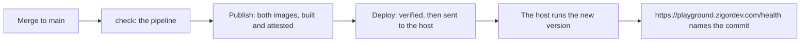

# How the playground reaches production

Every green merge to `main` deploys the playground to <https://playground.zigordev.com>, with no manual step. This page says how, what production needs once, and how to look after it. The handbook page [Delivery](https://github.com/zigordev/toolkit/blob/main/docs/handbook/delivery.md) explains every step in depth.

## The path of a merge

| Job     | What it does                                                                                                                                                           |
| ------- | ---------------------------------------------------------------------------------------------------------------------------------------------------------------------- |
| check   | toolkit's pipeline: `pnpm check`, the title, the dependencies, the code scan, and the contract on both built images                                                    |
| Publish | Builds `ghcr.io/zigordev/playground-api` and `ghcr.io/zigordev/playground-web` for arm64 under the commit, and records how each was built                              |
| Deploy  | Verifies both records, asks the host through AWS Systems Manager to run the commit, waits for `version` to be the commit from outside, and rolls back when it never is |

The three workflows are toolkit's, pinned to one commit of it in `.github/workflows/ci.yml`. Renovate proposes each new version of toolkit, and the merge of that update deploys it.

On the host, the deploy reads `compose.yaml`, `compose.production.yaml` and `.env.production.example` from `main`. It starts PostgreSQL, runs the job `playground-api-migrate` once, and then replaces each app with docker-rollout, which waits for the new container's health check and drains the old one.

## What production needs, once

None of these is in this repo. The owner does each of them once.

| What                                                                                                                                                          | Who                                                         |
| ------------------------------------------------------------------------------------------------------------------------------------------------------------- | ----------------------------------------------------------- |
| The deploy target `playground` in `platform/infra/products.json`, which brings its command, its role, the environment `production` and the address            | The platform session, with the owner's approval of the plan |
| The repo secret `AWS_ACCOUNT_ID`                                                                                                                              | The owner, in the repo's settings                           |
| `/playground/POSTGRES_PASSWORD`, `/playground/PLAYGROUND_API_DATABASE_PASSWORD` and `/playground/PLAYGROUND_API_KEYS` in AWS Parameter Store, as SecureString | The owner                                                   |
| Both image packages made public, after the first publish, if GitHub created them as private                                                                   | The owner, in each package's settings                       |
| The dependency graph switched on, which Dependency Review needs                                                                                               | The owner, in the repo's settings                           |

## Looking after it

| You want to                       | Do this                                                                                                                                                                    |
| --------------------------------- | -------------------------------------------------------------------------------------------------------------------------------------------------------------------------- |
| Know which version runs           | Open <https://playground.zigordev.com/health>. `version` is the commit                                                                                                     |
| See a deploy                      | Open the run of the merge on GitHub. Its summary names the commit, the version before it and the result                                                                    |
| Read the logs, traces and metrics | Grafana Cloud, under the services `playground-api`, `playground-api-migrate` and `playground-web`                                                                          |
| Undo a bad version                | A version that answers wrongly from outside is rolled back by the deploy itself. To undo one that answers well, revert its pull request: the revert deploys like any merge |
| Change a secret                   | The owner sets the new value in Parameter Store. The next deploy reads it                                                                                                  |
| Run a deploy again by hand        | Only with the owner's yes                                                                                                                                                  |
